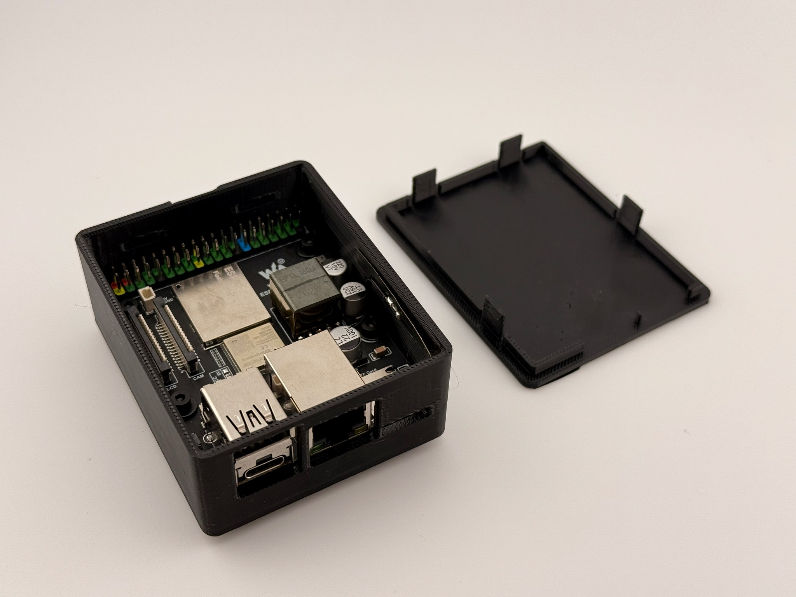

# Bridge enclosure

A 3D printed case for the Waveshare **ESP32-P4-WIFI6-POE-ETH** bridge board.

| File | What it is |
|---|---|
| `enclosure_base.stl` | The base. The board drops in, and the USB-A, USB-C, Ethernet and microSD openings line up with its ports. |
| `enclosure_lid.stl` | The lid. It snaps onto the base with clips. |
| `enclosure_assembly.step` | The whole assembly, including a simple model of the board, to edit in any CAD program. |

The base is about 75 × 61 mm and 29 mm tall.

## Printing

Any filament works (PLA or PETG). These settings are a starting point:

- 0.2 mm layers, 3 walls, 15 to 20% infill
- Print the base with its open side up and the lid with its flat top on the bed, so neither needs supports.

## Fitting the board

1. Slide the board in, port end first, so the ports sit in their openings.
2. Press the lid on until the clips click.
3. Plug in the Stream Deck (USB-A) and the PoE network cable.
